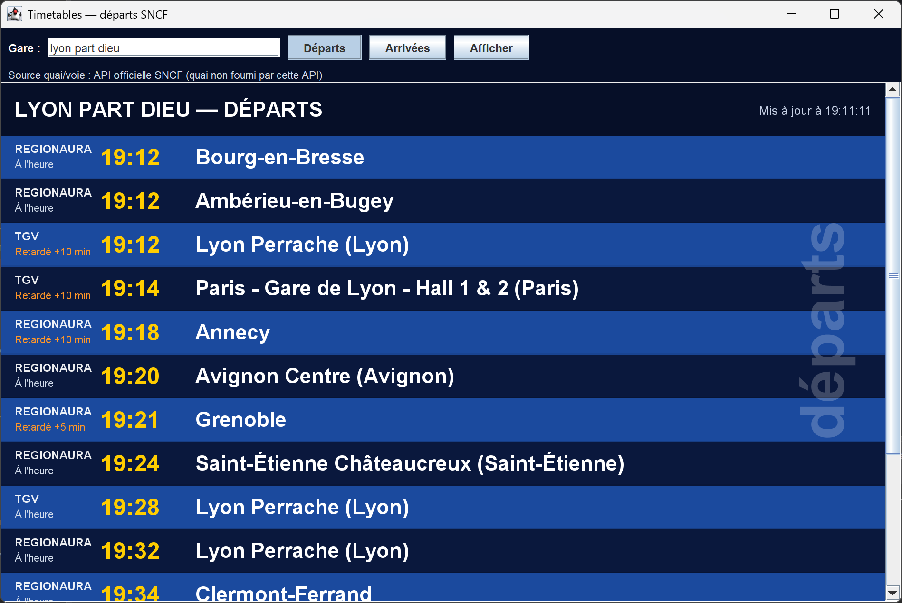
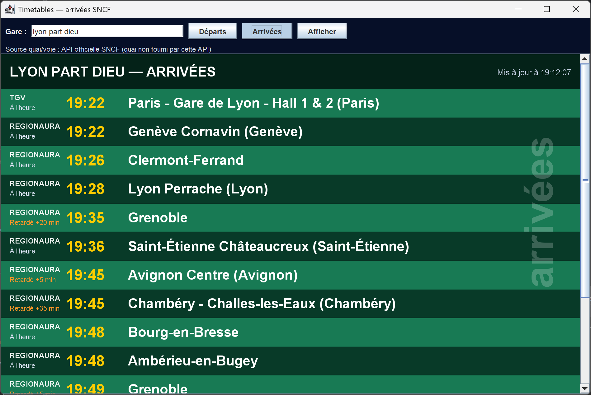

# Timetables

A Java recreation of the SNCF station display boards (departures in blue, arrivals in green),
built on the public SNCF API (Navitia). A project that is playful (recreating the atmosphere of
a station), didactic (learning to use a public REST API) and useful (personal use when travelling
by train).

Current state: proof of concept with departures and arrivals boards, in console and graphical (Swing)
versions. Architecture, graphical design and the mobile port will come in later phases.

## Screenshots

<table>
  <tr>
    <td align="center"></td>
    <td align="center"></td>
  </tr>
  <tr>
    <td align="center"><b>Departures</b> (blue board)</td>
    <td align="center"><b>Arrivals</b> (green board)</td>
  </tr>
</table>

## Configuration

1. Get a free API key at https://numerique.sncf.com/startup/api/token-developpeur/
2. Create the file `resources/Timetables.properties` (not versioned, see `.gitignore`) with:
   ```
   API_KEY=your_sncf_api_key
   ```

## Project structure

A Gradle build with two modules:

- `core`: pure Java (no Swing), SNCF API access, data model and platform providers. Network access goes
  through the `HttpTransport` interface, so the module can be reused by another front-end (Android later).
- `desktop`: Swing and console front-ends, built on `core`.

## Running the application

Two boards to choose from: departures (blue) and arrivals (green). You only need a JDK (17 or later);
Gradle is downloaded by the wrapper (`gradlew`) the first time. From the project root:

Graphical version (Swing): pick "Départs" or "Arrivées", type a station name, then click "Afficher".
The board refreshes every 30 seconds.

```
.\gradlew :desktop:run
```

Console version: asks for a station name, then (D)épart or (A)rrivées. In cmd.exe or PowerShell, run
`chcp 65001` first so that accents are displayed correctly.

```
.\gradlew --console=plain -q :desktop:runConsole
```

Tests (offline, no API key needed):

```
.\gradlew :core:test
```

On Linux or macOS, use `./gradlew` instead of `.\gradlew`.

In Eclipse, import the project with File > Import > Gradle > Existing Gradle Project, then right-click
`TimetablesApp.java` (or `TimetablesConsole.java`) in `desktop` > Run As > Java Application.

The boards show the next TER / TGV / Intercités / RER / Transilien trains (time, train,
destination or origin, platform, status). The user interface texts are in French.

The origin of arriving trains is not provided directly by the API: it is deduced from the
train's first stop (one call per train, cached). The platform is not provided by the official
API either, so it shows "--" (see `resources/Timetables.properties` for the experimental
alternative).
